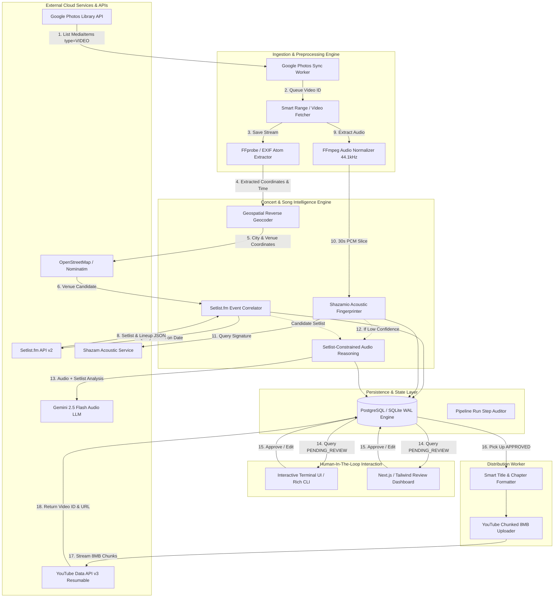
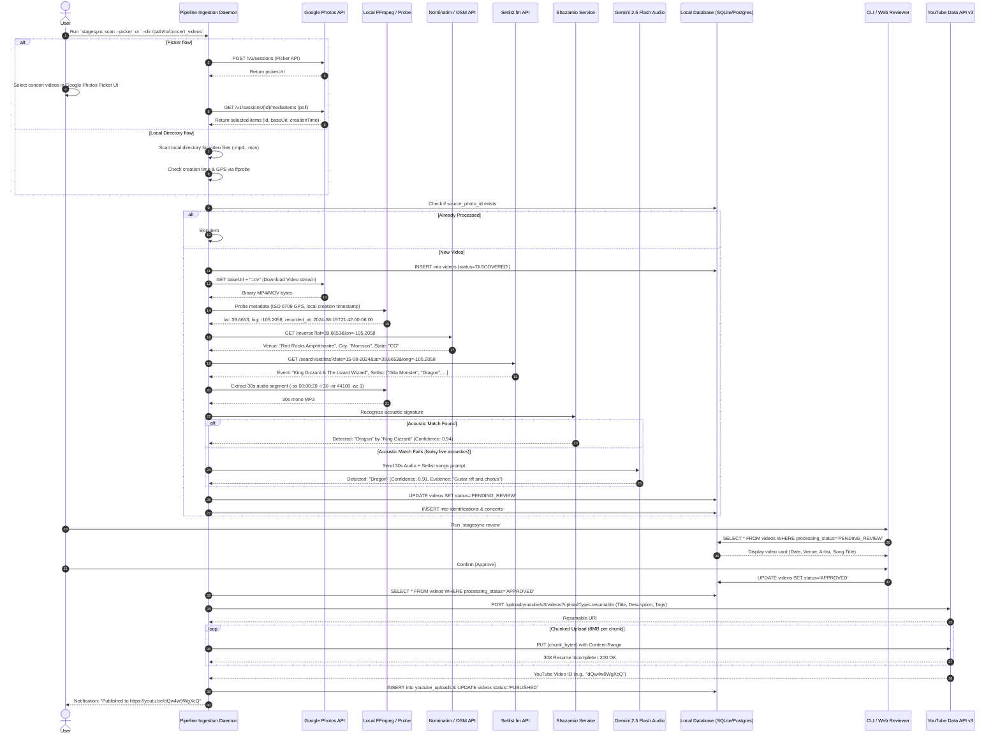
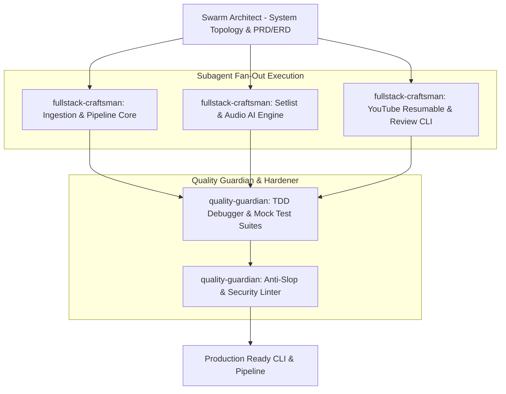

# StageSync (ConcertVault) - System Architecture & Engineering Documentation

---

## 1. System Topology & Architectural Blueprint

StageSync (ConcertVault) is built as a high-throughput, fault-tolerant media ingestion and processing pipeline. It bridges cloud photo storage, geospatial intelligence, concert registries, neural audio recognition, and video distribution channels.



---

## 2. Google Photos API Scope Change (2025)

Google deprecated the `photoslibrary.readonly` scope on March 31, 2025. This means the Library API can no longer scan a user's full photo library. The remaining valid scopes are:

- `photoslibrary.readonly.appcreateddata` — only returns media items created by this app
- `photospicker.mediaitems.readonly` — used by the Google Photos Picker API for user-selected videos
- `photoslibrary.appendonly` — for uploading, not discovery

**Recommended ingestion paths**:
1. **Picker flow** (`stagesync scan --picker`) — user selects videos from their library via Google's Picker UI
2. **Local Directory** (`stagesync scan --dir /path/to/concert_videos`) — scan a locally synced folder of concert videos
3. **App-created media only** (Library API `mediaItems:search`) — only returns videos previously uploaded by this app

---

## 3. End-to-End Sequence Lifecycle

The following sequence illustrates the exact execution path of a single concert video from Google Photos discovery through YouTube publication:



---

## 4. Directory & Component Boundaries

The project is structured as a high-cohesion, low-coupling modular workspace located in `/home/workspace/stagesync/`:

```
/home/workspace/stagesync/
├── pyproject.toml              # UV / Poetry dependencies (FastAPI, Typer, Shazamio, google-api-python-client)
├── README.md                   # Quickstart documentation
├── .env.example                # Canonical environment variable templates
│
├── stagesync/
│   ├── __init__.py
│   ├── config.py               # Pydantic v2 Settings (environment validation)
│   ├── cli.py                  # Typer / Rich CLI entry points
│   │
│   ├── core/                   # Core business logic & orchestrator
│   │   ├── pipeline.py         # Pipeline coordinator & DAG runner
│   │   ├── state_machine.py    # Transition rules (DISCOVERED -> PUBLISHED)
│   │   └── scheduler.py        # Proactive background cron watcher
│   │
│   ├── database/               # Relational persistence layer
│   │   ├── connection.py       # Engine & session management (SQLite / PostgreSQL)
│   │   ├── models.py           # SQLModel / SQLAlchemy 2.0 ORM definitions
│   │   └── migrations/         # Alembic migration revisions
│   │
│   ├── ingestion/              # Ingestion & container extraction
│   │   ├── google_photos.py    # Google Photos Library API client & OAuth handler
│   │   ├── ffmpeg_probe.py     # FFprobe QuickTime / MP4 atom extractor
│   │   └── audio_extractor.py  # Audio demuxing & loudness normalization
│   │
│   ├── intelligence/           # Show & song correlation
│   │   ├── geocoder.py         # Nominatim & Overpass reverse geocoding
│   │   ├── setlist_fm.py       # Setlist.fm API v2 client with rate limiter
│   │   ├── shazam_matcher.py   # Shazamio async audio fingerprinting
│   │   └── ai_audio_judge.py   # Gemini 2.5 Flash setlist-constrained analyzer
│   │
│   ├── publisher/              # YouTube distribution
│   │   ├── youtube_client.py   # YouTube Data API v3 OAuth & client
│   │   ├── resumable_upload.py # Resumable 8MB chunked streaming uploader
│   │   └── metadata_gen.py     # Title, description, tags, and chapter formatter
│   │
│   └── web/                    # FastAPI backend for Web Dashboard
│       ├── app.py              # FastAPI application server
│       ├── routes/             # REST endpoints (/videos, /pipeline, /status)
│       └── static/             # Built UI distribution or minimal dashboard
│
└── tests/                      # Pytest verification suite
    ├── unit/                   # Unit tests for metadata parsing & formatting
    ├── integration/            # Mocked API integration tests
    └── fixtures/               # Sample MP4 headers, setlist payloads, and audio slices
```

---

## 5. Step-by-Step Setup & Authentication Guide

### 4.1 Prerequisites & Toolchain Verification
Ensure all required system binaries are present:
```bash
which ffmpeg ffprobe python3 sqlite3
```
Install the project dependencies using `uv` or `pip`:
```bash
pip install typer rich requests google-auth google-auth-oauthlib google-api-python-client shazamio pydantic-settings sqlmodel alembic timezonefinder
```

### 4.2 Credentials Configuration (`.env`)
Create `/home/workspace/stagesync/.env`:
```ini
# Database (Defaults to local SQLite)
DATABASE_URL=sqlite:////home/workspace/stagesync/stagesync.db

# Google Photos API Credentials
GOOGLE_PHOTOS_CLIENT_ID=your_google_photos_client_id.apps.googleusercontent.com
GOOGLE_PHOTOS_CLIENT_SECRET=your_google_photos_client_secret
GOOGLE_PHOTOS_REDIRECT_URI=http://localhost:8090/callback

# YouTube Data API v3 Credentials
YOUTUBE_CLIENT_ID=your_youtube_client_id.apps.googleusercontent.com
YOUTUBE_CLIENT_SECRET=your_youtube_client_secret
YOUTUBE_REDIRECT_URI=http://localhost:8090/youtube_callback

# Music & Concert Intelligence APIs
SETLIST_FM_API_KEY=your_setlist_fm_api_key
GEMINI_API_KEY=your_gemini_api_key

# Pipeline Runtime Policy
STAGESYNC_DEFAULT_PRIVACY=unlisted     # private | unlisted | public
STAGESYNC_AUTO_APPROVE_THRESHOLD=0.92  # Confidence required to bypass manual review
STAGESYNC_MAX_DAILY_UPLOADS=5          # YouTube API quota preservation guardrail
```

### 4.3 Google Cloud Project & API Activation
1. Navigate to [Google Cloud Console](https://console.cloud.google.com).
2. Create or select a project (e.g., `stagesync-concerts`).
3. Enable the following APIs:
   - **Photos Library API**
   - **YouTube Data API v3**
4. Configure the **OAuth Consent Screen**:
   - User Type: **External**
   - Scopes:
     - `https://www.googleapis.com/auth/photoslibrary.readonly`
     - `https://www.googleapis.com/auth/youtube.upload`
   - Add your Google account under **Test Users**.
5. Create OAuth 2.0 Client IDs (Application Type: **Desktop app** or **Web application**).
6. Save Client ID and Client Secret in `.env`.

### 4.4 Setlist.fm API Key
1. Register an account at [Setlist.fm](https://www.setlist.fm).
2. Apply for an API Key at [Setlist.fm API Settings](https://www.setlist.fm/settings/api).
3. Save the generated key as `SETLIST_FM_API_KEY`.

---

## 6. CLI & Web UI Operational Specifications

### 5.1 Command-Line Interface (CLI)

#### 1. Authentication
```bash
# Authenticate Google Photos OAuth
stagesync auth google-photos

# Authenticate YouTube Data API OAuth
stagesync auth youtube

# Verify active credentials and quota status
stagesync auth status
```

#### 2. Discovery & Scanning
```bash
# Scan all videos from the past 30 days
stagesync scan --days 30

# Scan specific album
stagesync scan --album "ALBUM_ID_HERE"

# Dry-run scan (simulate EXIF extraction and concert matching without downloading full files)
stagesync scan --days 60 --dry-run
```

#### 3. Interactive Review & Approval
```bash
stagesync review
```
*TUI Output Layout*:
```text
================================================================================
StageSync Review [Candidate 1 of 4]
================================================================================
File:         PXL_20240815_214201.mp4 (Duration: 01:24 | Size: 184 MB)
Recorded At:  Thursday, August 15, 2024 at 9:42:01 PM MDT
Location:     Red Rocks Amphitheatre (Morrison, Colorado, USA)
[39.6653° N, 105.2058° W]

MATCHED SHOW:
  Artist:     King Gizzard & The Lizard Wizard
  Tour:       North America Tour 2024
  Lineup:     Geese (Opener), King Gizzard & The Lizard Wizard (Headliner)
  Setlist.fm: https://www.setlist.fm/setlist/king-gizzard-...-3bca982c.html

IDENTIFIED TRACK:
  Song:       Dragon (Track #9 of 21)
  Service:    shazamio (Confidence: 94.2%)
  Setlist:    Verified against Setlist.fm roster

TARGET YOUTUBE METADATA:
  Title:      King Gizzard & The Lizard Wizard - Dragon (Live at Red Rocks - Aug 15, 2024)
  Privacy:    unlisted
--------------------------------------------------------------------------------
[A] Approve & Queue Upload   [E] Edit Metadata   [P] Change Privacy   [R] Reject   [S] Skip
Selection: _
```

#### 4. Resumable Upload Dispatcher
```bash
# Upload all approved videos (respecting daily quota limit)
stagesync upload

# Force upload with public privacy override
stagesync upload --limit 3 --privacy public
```

---

## 7. Swarm Multi-Agent Execution Roadmap

To construct StageSync with zero regression and maximum engineering speed, the Swarm Director delegates tasks across specialized agents:



### Delegation Task Slices:
1. **Subagent `fullstack-craftsman` (Core Engine & Ingestion)**:
   - Scaffold project structure in `/home/workspace/stagesync/`.
   - Implement `database/models.py` and `database/connection.py` using SQLModel / SQLite WAL.
   - Implement `ingestion/google_photos.py` using Google Photos API + credentials at `~/.config/google-photos/credentials.json`.
   - Implement `ingestion/ffmpeg_probe.py` using `ffprobe` to extract ISO 6709 location atoms.
2. **Subagent `fullstack-craftsman` (Concert & Audio Intelligence)**:
   - Implement `intelligence/geocoder.py` (Nominatim reverse geocode with SQLite TTL cache).
   - Implement `intelligence/setlist_fm.py` (Setlist.fm API query with rate limiter).
   - Implement `intelligence/shazam_matcher.py` (Shazamio async client).
   - Implement `intelligence/ai_audio_judge.py` (Gemini 2.5 Flash setlist-constrained prompt).
3. **Subagent `fullstack-craftsman` (YouTube Publisher & Review CLI)**:
   - Implement `publisher/youtube_client.py` and `publisher/resumable_upload.py` (8MB chunk streaming).
   - Implement `publisher/metadata_gen.py` (Title and description formatting).
   - Implement `cli.py` with Typer + Rich for the interactive review workflow.
4. **Subagent `quality-guardian` (Testing, Hardening & Anti-Slop)**:
   - Create mock fixtures for Google Photos responses, Setlist.fm API payloads, and audio snippets.
   - Implement automated pytest suite covering 100% of EXIF parsing, setlist matching, and title templating.
   - Audit code against Anti-Slop 7 Pillars: no placeholder comments (`// TODO`), strict error handling, and type safety.
