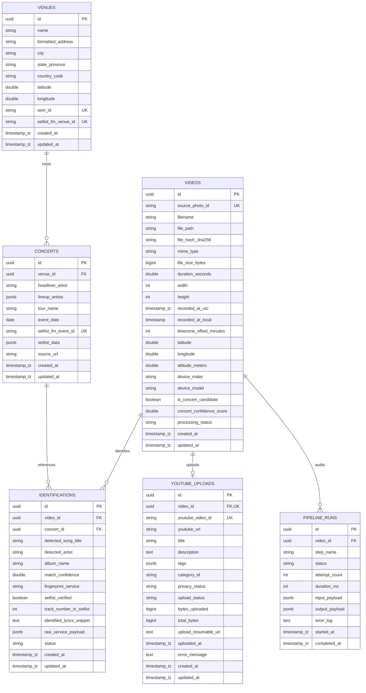
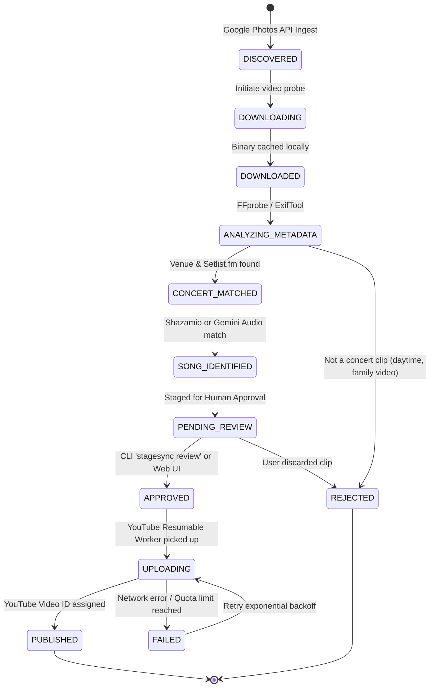

# Entity Relationship Diagram & Database Schema (ERD)
## StageSync (ConcertVault): Relational Data Architecture

---

## 1. Visual Entity Relationship Diagram



---

## 2. Relational Invariants & Data Integrity Rules

1. **Video Uniqueness**: `source_photo_id` is globally unique to prevent duplicate processing of the same Google Photos asset across repeated synchronizations.
2. **File De-duplication**: `file_hash_sha256` ensures identical video payloads uploaded under different Google Photos IDs are recognized and mapped to the existing entity.
3. **Venue Normalization**: Venues are de-duplicated by `setlist_fm_venue_id` and spatial closeness (`ST_DWithin(geom, 100 meters)`).
4. **1-to-1 YouTube Upload**: A video can only have one active `YOUTUBE_UPLOADS` record (`video_id` is unique in `youtube_uploads`).
5. **Setlist Association**: An `IDENTIFICATION` record optionally binds a `CONCERTS` foreign key. If a video captures a jam session or street performer with no registered concert, `concert_id` is `NULL` while retaining the acoustic identification.
6. **Auditability**: `PIPELINE_RUNS` tracks every discrete step (`DOWNLOAD`, `EXIF_EXTRACTION`, `GEO_LOOKUP`, `CONCERT_MATCH`, `SONG_IDENTIFY`, `YOUTUBE_UPLOAD`) with execution duration and error traces for zero-loss observability.

---

## 3. Production PostgreSQL DDL (PostgreSQL 16+)

```sql
-- Enable necessary extensions
CREATE EXTENSION IF NOT EXISTS "uuid-ossp";
CREATE EXTENSION IF NOT EXISTS "pgcrypto";

-- Custom Domain Enums
CREATE TYPE video_status AS ENUM (
    'DISCOVERED',
    'DOWNLOADING',
    'DOWNLOADED',
    'ANALYZING_METADATA',
    'CONCERT_MATCHED',
    'SONG_IDENTIFIED',
    'PENDING_REVIEW',
    'APPROVED',
    'REJECTED',
    'UPLOADING',
    'PUBLISHED',
    'FAILED'
);

CREATE TYPE privacy_level AS ENUM (
    'private',
    'unlisted',
    'public'
);

CREATE TYPE identification_provider AS ENUM (
    'shazamio',
    'gemini_multimodal',
    'audd',
    'acrcloud',
    'manual_user_override'
);

CREATE TYPE pipeline_step AS ENUM (
    'DISCOVERY',
    'DOWNLOAD',
    'EXIF_EXTRACTION',
    'REVERSE_GEOCODE',
    'CONCERT_SEARCH',
    'AUDIO_FINGERPRINT',
    'LLM_DISAMBIGUATION',
    'YOUTUBE_UPLOAD'
);

CREATE TYPE step_status AS ENUM (
    'PENDING',
    'IN_PROGRESS',
    'SUCCESS',
    'FAILED',
    'SKIPPED'
);

-- 1. Venues Table
CREATE TABLE venues (
    id UUID PRIMARY KEY DEFAULT gen_random_uuid(),
    name VARCHAR(255) NOT NULL,
    formatted_address TEXT,
    city VARCHAR(100) NOT NULL,
    state_province VARCHAR(100),
    country_code VARCHAR(10) NOT NULL,
    latitude DOUBLE PRECISION NOT NULL,
    longitude DOUBLE PRECISION NOT NULL,
    osm_id VARCHAR(100) UNIQUE,
    setlist_fm_venue_id VARCHAR(100) UNIQUE,
    created_at TIMESTAMP WITH TIME ZONE DEFAULT CURRENT_TIMESTAMP NOT NULL,
    updated_at TIMESTAMP WITH TIME ZONE DEFAULT CURRENT_TIMESTAMP NOT NULL
);

CREATE INDEX idx_venues_geo ON venues(latitude, longitude);
CREATE INDEX idx_venues_city ON venues(city, country_code);

-- 2. Concerts Table
CREATE TABLE concerts (
    id UUID PRIMARY KEY DEFAULT gen_random_uuid(),
    venue_id UUID REFERENCES venues(id) ON DELETE SET NULL,
    headliner_artist VARCHAR(255) NOT NULL,
    lineup_artists JSONB DEFAULT '[]'::jsonb NOT NULL,
    tour_name VARCHAR(255),
    event_date DATE NOT NULL,
    setlist_fm_event_id VARCHAR(100) UNIQUE,
    setlist_data JSONB DEFAULT '{}'::jsonb NOT NULL,
    source_url TEXT,
    created_at TIMESTAMP WITH TIME ZONE DEFAULT CURRENT_TIMESTAMP NOT NULL,
    updated_at TIMESTAMP WITH TIME ZONE DEFAULT CURRENT_TIMESTAMP NOT NULL
);

CREATE INDEX idx_concerts_artist ON concerts(headliner_artist);
CREATE INDEX idx_concerts_event_date ON concerts(event_date);
CREATE INDEX idx_concerts_venue_date ON concerts(venue_id, event_date);

-- 3. Videos Table
CREATE TABLE videos (
    id UUID PRIMARY KEY DEFAULT gen_random_uuid(),
    source_photo_id VARCHAR(255) NOT NULL UNIQUE,
    filename VARCHAR(255) NOT NULL,
    file_path TEXT,
    file_hash_sha256 CHAR(64),
    mime_type VARCHAR(100) DEFAULT 'video/mp4' NOT NULL,
    file_size_bytes BIGINT,
    duration_seconds DOUBLE PRECISION,
    width INTEGER,
    height INTEGER,
    recorded_at_utc TIMESTAMP WITH TIME ZONE,
    recorded_at_local TIMESTAMP WITHOUT TIME ZONE,
    timezone_offset_minutes INTEGER,
    latitude DOUBLE PRECISION,
    longitude DOUBLE PRECISION,
    altitude_meters DOUBLE PRECISION,
    device_make VARCHAR(100),
    device_model VARCHAR(100),
    is_concert_candidate BOOLEAN DEFAULT FALSE NOT NULL,
    concert_confidence_score DOUBLE PRECISION DEFAULT 0.0 NOT NULL,
    processing_status video_status DEFAULT 'DISCOVERED' NOT NULL,
    created_at TIMESTAMP WITH TIME ZONE DEFAULT CURRENT_TIMESTAMP NOT NULL,
    updated_at TIMESTAMP WITH TIME ZONE DEFAULT CURRENT_TIMESTAMP NOT NULL
);

CREATE INDEX idx_videos_status ON videos(processing_status);
CREATE INDEX idx_videos_recorded_at ON videos(recorded_at_utc);
CREATE INDEX idx_videos_is_candidate ON videos(is_concert_candidate) WHERE is_concert_candidate = TRUE;
CREATE INDEX idx_videos_coords ON videos(latitude, longitude) WHERE latitude IS NOT NULL AND longitude IS NOT NULL;

-- 4. Identifications Table
CREATE TABLE identifications (
    id UUID PRIMARY KEY DEFAULT gen_random_uuid(),
    video_id UUID NOT NULL REFERENCES videos(id) ON DELETE CASCADE,
    concert_id UUID REFERENCES concerts(id) ON DELETE SET NULL,
    detected_song_title VARCHAR(255) NOT NULL,
    detected_artist VARCHAR(255) NOT NULL,
    album_name VARCHAR(255),
    match_confidence DOUBLE PRECISION NOT NULL CHECK (match_confidence >= 0.0 AND match_confidence <= 1.0),
    fingerprint_service identification_provider NOT NULL,
    setlist_verified BOOLEAN DEFAULT FALSE NOT NULL,
    track_number_in_setlist INTEGER,
    identified_lyrics_snippet TEXT,
    raw_service_payload JSONB DEFAULT '{}'::jsonb NOT NULL,
    status VARCHAR(50) DEFAULT 'CONFIRMED' NOT NULL,
    created_at TIMESTAMP WITH TIME ZONE DEFAULT CURRENT_TIMESTAMP NOT NULL,
    updated_at TIMESTAMP WITH TIME ZONE DEFAULT CURRENT_TIMESTAMP NOT NULL
);

CREATE INDEX idx_identifications_video ON identifications(video_id);
CREATE INDEX idx_identifications_concert ON identifications(concert_id);
CREATE INDEX idx_identifications_song ON identifications(detected_artist, detected_song_title);

-- 5. YouTube Uploads Table
CREATE TABLE youtube_uploads (
    id UUID PRIMARY KEY DEFAULT gen_random_uuid(),
    video_id UUID NOT NULL UNIQUE REFERENCES videos(id) ON DELETE CASCADE,
    youtube_video_id VARCHAR(50) UNIQUE,
    youtube_url TEXT,
    title VARCHAR(100) NOT NULL,
    description TEXT NOT NULL,
    tags JSONB DEFAULT '[]'::jsonb NOT NULL,
    category_id VARCHAR(10) DEFAULT '10' NOT NULL, -- 10 = Music
    privacy_status privacy_level DEFAULT 'unlisted' NOT NULL,
    upload_status VARCHAR(50) DEFAULT 'DRAFT' NOT NULL,
    bytes_uploaded BIGINT DEFAULT 0 NOT NULL,
    total_bytes BIGINT DEFAULT 0 NOT NULL,
    upload_resumable_uri TEXT,
    uploaded_at TIMESTAMP WITH TIME ZONE,
    error_message TEXT,
    created_at TIMESTAMP WITH TIME ZONE DEFAULT CURRENT_TIMESTAMP NOT NULL,
    updated_at TIMESTAMP WITH TIME ZONE DEFAULT CURRENT_TIMESTAMP NOT NULL
);

CREATE INDEX idx_youtube_uploads_status ON youtube_uploads(upload_status);
CREATE INDEX idx_youtube_uploads_video_id ON youtube_uploads(youtube_video_id);

-- 6. Pipeline Runs Audit Table
CREATE TABLE pipeline_runs (
    id UUID PRIMARY KEY DEFAULT gen_random_uuid(),
    video_id UUID NOT NULL REFERENCES videos(id) ON DELETE CASCADE,
    step_name pipeline_step NOT NULL,
    status step_status DEFAULT 'PENDING' NOT NULL,
    attempt_count INTEGER DEFAULT 1 NOT NULL,
    duration_ms INTEGER,
    input_payload JSONB DEFAULT '{}'::jsonb NOT NULL,
    output_payload JSONB DEFAULT '{}'::jsonb NOT NULL,
    error_log TEXT,
    started_at TIMESTAMP WITH TIME ZONE DEFAULT CURRENT_TIMESTAMP NOT NULL,
    completed_at TIMESTAMP WITH TIME ZONE
);

CREATE INDEX idx_pipeline_runs_video ON pipeline_runs(video_id);
CREATE INDEX idx_pipeline_runs_step_status ON pipeline_runs(step_name, status);

-- Trigger to auto-update updated_at timestamps
CREATE OR REPLACE FUNCTION set_updated_at()
RETURNS TRIGGER AS $$
BEGIN
    NEW.updated_at = CURRENT_TIMESTAMP;
    RETURN NEW;
END;
$$ LANGUAGE plpgsql;

CREATE TRIGGER trg_venues_updated BEFORE UPDATE ON venues FOR EACH ROW EXECUTE FUNCTION set_updated_at();
CREATE TRIGGER trg_concerts_updated BEFORE UPDATE ON concerts FOR EACH ROW EXECUTE FUNCTION set_updated_at();
CREATE TRIGGER trg_videos_updated BEFORE UPDATE ON videos FOR EACH ROW EXECUTE FUNCTION set_updated_at();
CREATE TRIGGER trg_identifications_updated BEFORE UPDATE ON identifications FOR EACH ROW EXECUTE FUNCTION set_updated_at();
CREATE TRIGGER trg_youtube_uploads_updated BEFORE UPDATE ON youtube_uploads FOR EACH ROW EXECUTE FUNCTION set_updated_at();
```

---

## 4. Local SQLite 3 DDL (Embedded Desktop & CLI Engine)

For standalone local CLI operation without requiring an external PostgreSQL instance, StageSync natively supports SQLite 3:

```sql
PRAGMA foreign_keys = ON;
PRAGMA journal_mode = WAL;

-- 1. Venues Table
CREATE TABLE IF NOT EXISTS venues (
    id TEXT PRIMARY KEY,
    name TEXT NOT NULL,
    formatted_address TEXT,
    city TEXT NOT NULL,
    state_province TEXT,
    country_code TEXT NOT NULL,
    latitude REAL NOT NULL,
    longitude REAL NOT NULL,
    osm_id TEXT UNIQUE,
    setlist_fm_venue_id TEXT UNIQUE,
    created_at TEXT DEFAULT (datetime('now')) NOT NULL,
    updated_at TEXT DEFAULT (datetime('now')) NOT NULL
);

CREATE INDEX IF NOT EXISTS idx_venues_geo ON venues(latitude, longitude);

-- 2. Concerts Table
CREATE TABLE IF NOT EXISTS concerts (
    id TEXT PRIMARY KEY,
    venue_id TEXT REFERENCES venues(id) ON DELETE SET NULL,
    headliner_artist TEXT NOT NULL,
    lineup_artists TEXT DEFAULT '[]' NOT NULL, -- JSON String
    tour_name TEXT,
    event_date TEXT NOT NULL, -- YYYY-MM-DD
    setlist_fm_event_id TEXT UNIQUE,
    setlist_data TEXT DEFAULT '{}' NOT NULL, -- JSON String
    source_url TEXT,
    created_at TEXT DEFAULT (datetime('now')) NOT NULL,
    updated_at TEXT DEFAULT (datetime('now')) NOT NULL
);

CREATE INDEX IF NOT EXISTS idx_concerts_date ON concerts(event_date);
CREATE INDEX IF NOT EXISTS idx_concerts_artist ON concerts(headliner_artist);

-- 3. Videos Table
CREATE TABLE IF NOT EXISTS videos (
    id TEXT PRIMARY KEY,
    source_photo_id TEXT NOT NULL UNIQUE,
    filename TEXT NOT NULL,
    file_path TEXT,
    file_hash_sha256 TEXT,
    mime_type TEXT DEFAULT 'video/mp4' NOT NULL,
    file_size_bytes INTEGER,
    duration_seconds REAL,
    width INTEGER,
    height INTEGER,
    recorded_at_utc TEXT, -- ISO8601
    recorded_at_local TEXT,
    timezone_offset_minutes INTEGER,
    latitude REAL,
    longitude REAL,
    altitude_meters REAL,
    device_make TEXT,
    device_model TEXT,
    is_concert_candidate INTEGER DEFAULT 0 NOT NULL,
    concert_confidence_score REAL DEFAULT 0.0 NOT NULL,
    processing_status TEXT DEFAULT 'DISCOVERED' NOT NULL,
    created_at TEXT DEFAULT (datetime('now')) NOT NULL,
    updated_at TEXT DEFAULT (datetime('now')) NOT NULL
);

CREATE INDEX IF NOT EXISTS idx_videos_status ON videos(processing_status);
CREATE INDEX IF NOT EXISTS idx_videos_candidate ON videos(is_concert_candidate);

-- 4. Identifications Table
CREATE TABLE IF NOT EXISTS identifications (
    id TEXT PRIMARY KEY,
    video_id TEXT NOT NULL REFERENCES videos(id) ON DELETE CASCADE,
    concert_id TEXT REFERENCES concerts(id) ON DELETE SET NULL,
    detected_song_title TEXT NOT NULL,
    detected_artist TEXT NOT NULL,
    album_name TEXT,
    match_confidence REAL NOT NULL,
    fingerprint_service TEXT NOT NULL,
    setlist_verified INTEGER DEFAULT 0 NOT NULL,
    track_number_in_setlist INTEGER,
    identified_lyrics_snippet TEXT,
    raw_service_payload TEXT DEFAULT '{}' NOT NULL, -- JSON String
    status TEXT DEFAULT 'CONFIRMED' NOT NULL,
    created_at TEXT DEFAULT (datetime('now')) NOT NULL,
    updated_at TEXT DEFAULT (datetime('now')) NOT NULL
);

CREATE INDEX IF NOT EXISTS idx_identifications_video ON identifications(video_id);

-- 5. YouTube Uploads Table
CREATE TABLE IF NOT EXISTS youtube_uploads (
    id TEXT PRIMARY KEY,
    video_id TEXT NOT NULL UNIQUE REFERENCES videos(id) ON DELETE CASCADE,
    youtube_video_id TEXT UNIQUE,
    youtube_url TEXT,
    title TEXT NOT NULL,
    description TEXT NOT NULL,
    tags TEXT DEFAULT '[]' NOT NULL, -- JSON String
    category_id TEXT DEFAULT '10' NOT NULL,
    privacy_status TEXT DEFAULT 'unlisted' NOT NULL,
    upload_status TEXT DEFAULT 'DRAFT' NOT NULL,
    bytes_uploaded INTEGER DEFAULT 0 NOT NULL,
    total_bytes INTEGER DEFAULT 0 NOT NULL,
    upload_resumable_uri TEXT,
    uploaded_at TEXT,
    error_message TEXT,
    created_at TEXT DEFAULT (datetime('now')) NOT NULL,
    updated_at TEXT DEFAULT (datetime('now')) NOT NULL
);

CREATE INDEX IF NOT EXISTS idx_youtube_uploads_status ON youtube_uploads(upload_status);

-- 6. Pipeline Runs Audit Table
CREATE TABLE IF NOT EXISTS pipeline_runs (
    id TEXT PRIMARY KEY,
    video_id TEXT NOT NULL REFERENCES videos(id) ON DELETE CASCADE,
    step_name TEXT NOT NULL,
    status TEXT DEFAULT 'PENDING' NOT NULL,
    attempt_count INTEGER DEFAULT 1 NOT NULL,
    duration_ms INTEGER,
    input_payload TEXT DEFAULT '{}' NOT NULL,
    output_payload TEXT DEFAULT '{}' NOT NULL,
    error_log TEXT,
    started_at TEXT DEFAULT (datetime('now')) NOT NULL,
    completed_at TEXT
);

CREATE INDEX IF NOT EXISTS idx_pipeline_runs_video ON pipeline_runs(video_id);
```

---

## 5. State Machine Lifecycle


